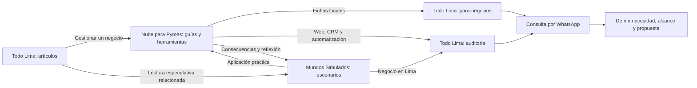

# Integración de Todo Lima, Nube para Pymes y Mundos Simulados

Revisión del 11 de octubre de 2026. Se inspeccionaron páginas públicas, destinos reales de los enlaces, código local de los tres proyectos y la publicación editorial de Todo Lima.

## Conclusión

La integración encontrada tiene una base útil, pero estaba incompleta como recorrido comercial. Había enlaces entre proyectos; no todos llevaban a una acción coherente con el texto del botón. La existencia de enlaces no demuestra ventas ni hace autosustentable el ecosistema.

El criterio aplicado, confirmado por el propietario, es priorizar **ambas conversiones según el tema**: fichas comerciales para presencia local, y consultas digitales para web, organización de consultas y automatización.

## Evidencia inicial

| Recorrido | Lo que se encontró | Problema |
| --- | --- | --- |
| Nube → Todo Lima | Puentes en 12 artículos y banners en herramientas | Algunos botones enviaban a la portada o a directorios sin explicar el siguiente paso para el propietario de un negocio |
| Nube → Mundos | Sin enlaces en los artículos inspeccionados del sitio generado | Faltaba este recorrido |
| Todo Lima → Nube | Página de herramientas con enlaces a aplicaciones gratuitas | Buena relación temática; faltaba un puente editorial para el lector que gestiona un negocio |
| Todo Lima → Mundos | Un artículo publicado enlazaba la portada de Mundos como lectura complementaria | Destino genérico; debía distinguirse ficción especulativa de fuentes informativas sobre Lima |
| Mundos → Todo Lima | 25 artículos locales tenían puentes y la portada enlazaba Todo Lima | Varias recomendaciones conducían a directorios, algunas con una relación temática débil |
| Mundos → Nube | Enlace en la portada; no se encontró en los artículos inspeccionados | Faltaba una continuación práctica para escenarios sobre trabajo, educación y negocios |
| Destino comercial | `/auditoria` de Todo Lima contenía un `redirect('/')` | El lector perdía la intención de la consulta digital |
| Autor | Dominios anteriores o variante `cabellosalirosas` | El destino solicitado es `https://xavier.cabellosalirrosas.com` |

## Recorridos implementados

- **Nube para Pymes:** 14 temas con recomendaciones hacia Todo Lima, tanto en español como en inglés: 28 bloques. Ocho temas llevan a revisión/publicación de ficha y seis a consulta digital. Tres temas añaden lectura complementaria en Mundos. Los banners de herramientas que prometían publicar una ficha llevan ahora a `/para-negocios`.
- **Todo Lima:** `/auditoria` presenta los tipos de necesidad, el proceso de consulta y un botón hacia el WhatsApp oficial. Mantiene una opción distinta para fichas. Los artículos sobre negocios incorporan recursos de Nube; las dos lecturas publicadas sobre visitas culturales incorporan un escenario de turismo virtual que sí contiene un artículo público.
- **Mundos Simulados:** tres artículos públicos válidos —profesores IA, robots con derechos laborales y turismo virtual— ofrecen una continuación práctica en Nube y una consulta digital en Todo Lima para negocios ubicados en Lima. La publicación estática conserva los créditos y estos bloques.
- **Autor:** los créditos apuntan al dominio solicitado. La normalización de Nube cubre HTML y bundles generados, incluidos los pies de página alternativos.
- **Atribución:** los nuevos enlaces contextuales usan `utm_source`, `utm_medium=referral`, `utm_campaign=ecosistema` y `utm_content` para identificar el artículo de origen. No se añadió un servicio de analítica ni se activó seguimiento adicional.

## Publicación editorial de Todo Lima

El archivo público contiene tres artículos. La cola tiene 179 pendientes y uno de sus artículos ya publicado; las otras dos publicaciones iniciales están fuera de esa cola. El workflow libera un artículo a las 08:00, 14:00 y 20:00 de Lima: tres al día, con los posibles retrasos de GitHub Actions.

La revisión no ejecutó el publicador ni alteró el contenido de `data/blog/posts.json`, la cola o el workflow. Se comprobó su conservación mediante hashes. Los nuevos bloques son de la plantilla; no adelantan la publicación de borradores.

## Hallazgo importante pendiente en Mundos

Estas páginas públicas devolvieron HTTP 200, pero mostraban **“429 — Too Many Requests”** en lugar de un artículo:

- `/apagon-global-internet-7-dias/`
- `/desempleo-global-automatizacion/`
- `/clonacion-voz-estafas/`
- `/codigo-autonomo-programacion-ia/`
- `/arquitectura-dinamica-ciudades/`
- `/mundo-gobernado-por-ia/`
- `/ciudades-inteligentes-control/`

Se excluyeron esos destinos de los nuevos enlaces. Es una exportación de una página de error, no una limitación temporal del navegador. Los cambios editoriales locales de Mundos están pendientes de publicación y no se incluyeron en el commit aislado de enlaces y créditos. La reparación de todos esos artículos requiere cerrar esa revisión editorial y validar el contenido recuperado antes de publicarlo.

## Verificación y límites

- Compilación estática de Todo Lima, validación de 56 JSON de directorios y 5.068 registros.
- Nube: 228 pares de idiomas, 12.061 referencias locales de imágenes y 610 páginas con enlaces internos sin destinos faltantes.
- Verificación de 33 rutas de Nube para comprobar destinos por intención, parámetros de atribución, créditos y ausencia de bloques duplicados.
- Chrome a 390 y 1.366 píxeles: recorrido de Nube a consulta digital/WhatsApp, recorrido de ficha, Todo Lima hacia recursos de Nube/Mundos y Mundos hacia Nube/Todo Lima. No se enviaron mensajes por WhatsApp.
- Cinco escenarios seleccionados de Mundos fueron comprobados contra el sitio público; contienen artículos reales.

Para evaluar autosustentabilidad falta medir visitas referidas, clics de contacto, consultas cualificadas, propuestas y clientes que contratan. Un clic de WhatsApp no equivale a una venta. La analítica existente de Todo Lima depende de su configuración y consentimiento; esta revisión no confirma datos de ventas ni de atribución histórica.

Próxima prioridad: completar la reparación editorial de Mundos, revisar destinos cuando se publiquen nuevas tandas y comparar semanalmente los dos recorridos comerciales. Los enlaces deben responder al tema y al siguiente paso del lector; no hace falta introducir las tres marcas en cada artículo.
